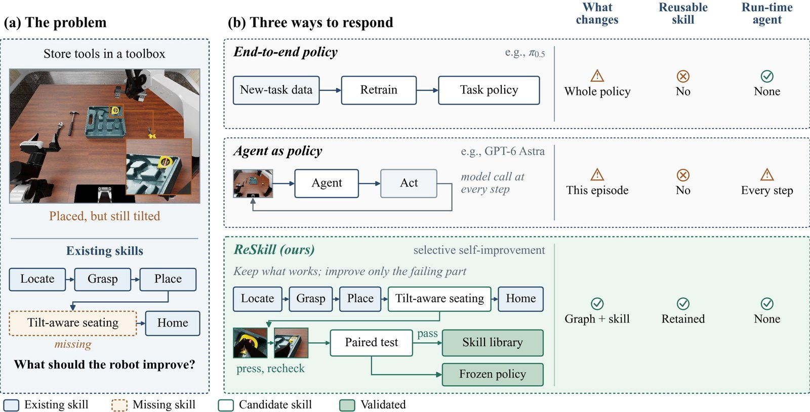
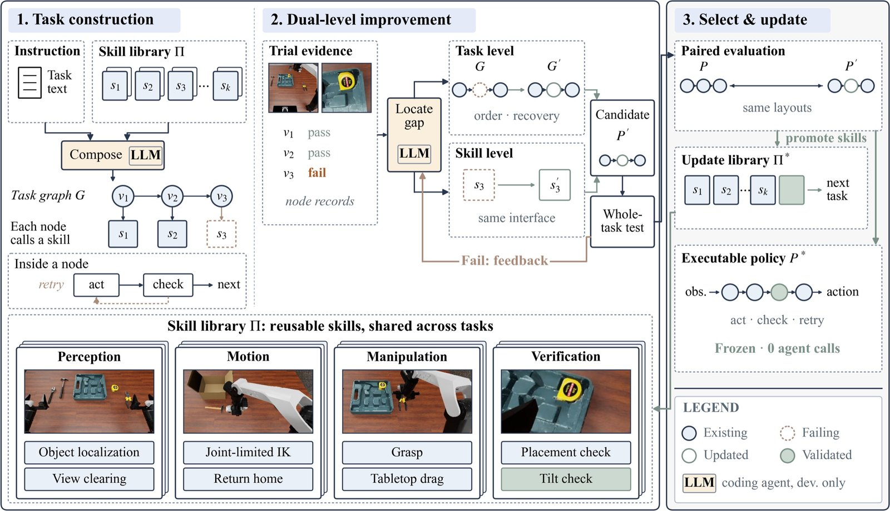

<div align="center">

# ReSkill: Selective Self-Improvement for Robot Manipulation

Zheng Sun<sup>1,\*</sup>, Zhihao Li<sup>1,\*</sup>, Zhuo Li<sup>1,\*</sup>, Wenrui Liu<sup>1</sup>, Xin Wang<sup>2</sup>, Fei Chen<sup>1,†</sup>

<sup>1</sup>The Chinese University of Hong Kong &nbsp;&nbsp; <sup>2</sup>Openmind Intelligent Robot Co., Ltd.

<sup>\*</sup>Equal contribution &nbsp;&nbsp; <sup>†</sup>Corresponding author

[](https://arxiv.org/abs/2611.10510)
[](https://zainzh.github.io/ReSkill/)
[](https://arxiv.org/abs/2611.10510)

**Follow-up work:** [RESET: One Demonstration, One Verified World, Self-Improved Skills Across Embodiments](https://zainzh.github.io/RESET/) (project page).

</div>

<p align="center">
  
</p>

<p align="center"><em>Instead of retraining a whole policy or calling an agent at every step, ReSkill keeps the parts
of a task program that work, improves only the failing part, and retains validated skills and a frozen policy.</em></p>

## Overview

ReSkill is a selective self-improvement framework for compositional manipulation tasks. During
development, a coding agent composes an **object-centric task graph** from the task instruction and a
**reusable skill library**, runs it, and uses **node-level execution records** to locate the node that
fails. It then revises the program at one of two scales: at the **task level** (stage organization,
hand-off conditions, recovery routes) or at the **skill level** (perception, motion, manipulation and
verification skills that repeatedly fail). Each candidate revision goes through **multi-stage
evaluation** and a **paired comparison** with the incumbent on the same test layouts before it is
adopted, and validated skills are promoted to the library for later tasks. The result is a **frozen
program**: ordinary Python that runs without any agent or language-model call at run time.

## Method

<p align="center">
  
</p>

- **Task construction.** A coding agent composes a task graph from the instruction and the skill
  library; each node calls a library skill and runs an act–check–retry loop.
- **Failure localization.** Node records from trial execution identify the earliest node that
  deviates, so revision targets the capability gap rather than the whole program.
- **Two-level revision.** The agent either revises the task graph (stage order, hand-off conditions,
  recovery routes) or changes a skill implementation behind the same interface.
- **Selection and adoption.** Each candidate is evaluated on the whole task; candidates that pass
  development and robustness evaluation are compared with the incumbent on the same layouts before
  they are adopted.
- **Skill accumulation and deployment.** Validated skills are promoted to the shared library for
  later tasks, and the retained program is deployed as a frozen policy with no run-time agent calls.

## Results

Retained programs on the ten RoboDojo tasks (Table 1 of the paper):

| Task | Successes | Success rate (%) |
|---|---:|---:|
| `stack_blocks` | 31/32 | 96.9 |
| `stack_blocks_by_language` | 27/27 | 100.0 |
| `general_pickup` | 51/57 | 89.5 |
| `stack_bowls` | 21/22 | 95.5 |
| `build_tower` | 37/37 | 100.0 |
| `classify_objects` | 22/25 | 88.0 |
| `classify_objects_by_language` | 20/27 | 74.1 |
| `organize_table` | 15/36 | 41.7 |
| `pack_objects_into_box` | 17/27 | 63.0 |
| `store_tools_in_toolbox` | 41/47 | 87.2 |
| **Average** | **282/337** | **83.6** |

Successes are counted over the recorded robustness and model-selection evaluations (seed 1,
layouts 10–54), as reported in the paper.

Highlights from the analysis:

- On the same development set, average success rises from **30.0%** for the initial task graphs to
  **86.2%** for the final adopted programs.
- Revisions are local: the median revision changes **3 functions, about 0.5%** of a program.
- Skills are reused: **39%** of the task-specific functions in the four tasks added later in
  development are identical to a function in another task.
- The deployed programs make **zero** agent calls at run time.

## What's in this repository

```
ReSkill/
  devloop/     the iterative self-improvement algorithm: coding-agent orchestration, evaluation
               queue, multi-stage evaluation, paired comparison and adoption
  programs/    the final programs for the ten RoboDojo tasks, one self-contained program per task
```

See [devloop/README.md](devloop/README.md) for how the development loop is organized and run.

## Getting started

### Requirements

- The [RoboDojo](https://arxiv.org/abs/2607.04434) benchmark and its evaluation client. Set
  `ROBODOJO_ROOT` to your RoboDojo checkout.
- Python, and a GPU for simulation.
- Segmentation services: the bundled SAM 2.1 service for all tasks, plus a SAM 3 service for five
  of them (see [Inputs and run-time calls](#inputs-and-run-time-calls)). The SAM 3 service is not
  included.

### Launching a program

The programs plug into the RoboDojo evaluation client in one of two ways:

- **In-process** (`stack_blocks`, `stack_bowls`, `build_tower`, `classify_objects`,
  `organize_table`, `store_tools_in_toolbox`): `runner/bootstrap.py` starts the native client and
  registers `runner/deploy.py:eval_one_episode` as the policy, which builds the task graph from
  `tasks/<task>/graph.py` and executes it in-process.
- **Separate policy server** (`general_pickup`, `stack_blocks_by_language`,
  `classify_objects_by_language`, `pack_objects_into_box`): `runner/bootstrap_ps.py` starts a
  policy-server process (`runner/ps_server.py`, `ps_model.py`); the task graph runs there through
  `runner/controller.py`, and `deploy.py` only forwards observations and actions over the official
  client.

At start-up `agraph/candidates.py` checks every file against the program's `CANDIDATE.json`; after
editing a program, regenerate that file.

> **Note.** Paths default to a generic local setup (`ROBODOJO_ROOT`, `SAM2_CHECKPOINT`, ...) and may
> need to be adapted.

## Program layout

```
programs/<task>/
  tasks/<task>/graph.py    object-centric task graph: nodes, conditions, edges, recovery routes
  tasks/<task>/params.json task parameters
  agraph/                  skill library: perception, kinematics/motion, manipulation (skills.py,
                           carry.py), verification, and the graph executor (contract.py)
  runner/                  RoboDojo integration: policy hook, episode lifecycle, input audit
  runtime_params.json      runtime parameters
  CANDIDATE.json           file checksums checked at start-up
```

Each program is self-contained and carries its own copy of `agraph/` and `runner/`. Shared skill
files are mostly identical across tasks; where a task improved a shared skill, its copy differs.

## Inputs and run-time calls

At run time a program uses only head and wrist RGB-D images (simulator RGB and depth of the
benchmark cameras), camera calibration, joint states, the robot model and the instruction text.
The policy-server programs read depth from the observation, so the RoboDojo observation config must
enable `vision.depth`. It does not read simulator state, and the benchmark's native
criterion alone scores the episode.

Object masks come from frozen SAM segmentation models served locally: the bundled SAM 2.1 service
(`agraph/vendor/sam_service.py`, endpoint `sam_endpoint` in `runtime_params.json`) for all tasks,
and additionally a SAM 3 service (`sam3_endpoint`, see `agraph/local_ground.py`) for
`general_pickup`, `stack_blocks_by_language`, `classify_objects`, `classify_objects_by_language`
and `pack_objects_into_box`. The SAM 3 service itself is not included.

The deployed programs make no language-model or other remote API calls at run time.

## Citation

```bibtex
@article{sun2026reskill,
  title   = {ReSkill: Selective Self-Improvement for Robot Manipulation},
  author  = {Sun, Zheng and Li, Zhihao and Li, Zhuo and Liu, Wenrui and Wang, Xin and Chen, Fei},
  journal = {arXiv preprint arXiv:2611.10510},
  year    = {2026}
}
```

## License

License: to be announced.

## Acknowledgements

We thank the authors of the [RoboDojo](https://arxiv.org/abs/2607.04434) benchmark and of the SAM
segmentation models.

